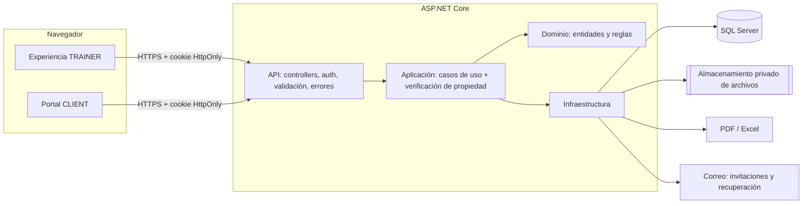
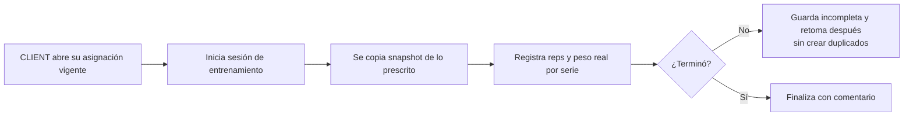
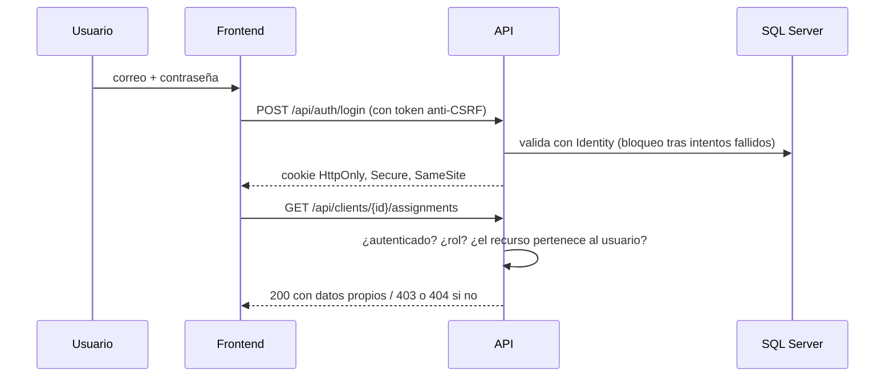
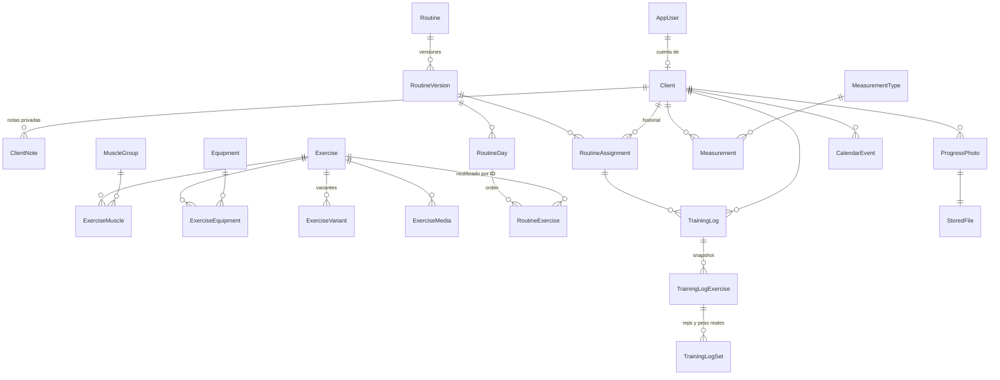

# LB METHOD · Fase 1: Análisis del proyecto y arquitectura

> Estado: **propuesta pendiente de aprobación**. Este documento no implementa módulos; describe el diagnóstico, la arquitectura recomendada y las decisiones que requieren la aprobación de Leilani antes de iniciar la Fase 2.
>
> Fuente oficial: *LB METHOD · Guía maestra de desarrollo, versión 1.0 (30 de octubre de 2026)*.

---

## 1. Diagnóstico del repositorio

### 1.1 Qué se inspeccionó

| Elemento | Resultado |
|---|---|
| Repositorio `leilapp/LBMETHOD1.0` (remoto) | **Vacío**: sin commits, sin ramas, sin archivos. |
| Copia local clonada | Solo la carpeta `.git`; ningún archivo de código, configuración ni datos. |
| Frontend (React / Vite / `package.json`) | No existe. |
| Backend (`.sln`, `.csproj`, `Program.cs`) | No existe. |
| Base de datos (`DbContext`, migraciones, scripts SQL) | No existe. |
| Configuración (`appsettings*.json`, `.env`, cadenas de conexión) | No existe. No hay secretos expuestos. |
| Archivos compartidos del proyecto | Solo la guía maestra en PDF. |

**Conclusión:** el proyecto parte de cero. No hay código existente que conservar, reutilizar o que pueda romperse, ni deuda técnica previa. Tampoco hay una base de datos con información que respaldar todavía.

> Si existe código o una base de datos de LB METHOD **fuera de este repositorio** (por ejemplo, en tu computadora), avísame antes de la Fase 2 para inspeccionarlo y no duplicar trabajo.

### 1.2 Entorno de trabajo en la nube (donde yo ejecuto)

| Herramienta | Disponible | Comentario |
|---|---|---|
| Node.js | Sí, v22.22.0 | Suficiente para React + Vite. |
| npm | Sí, 10.9.4 | Acceso al registro de paquetes: sí. |
| .NET SDK | **No** | La descarga desde `builds.dotnet.microsoft.com` está **bloqueada** por la política de red del entorno. |
| SQL Server | **No** | Docker está instalado pero su servicio no está activo, así que no puedo levantar SQL Server en contenedor. |
| NuGet (paquetes .NET) | Acceso de red: sí | Pero sin SDK no se puede compilar. |

**Impacto:** a partir de la Fase 2 necesito compilar C# y aplicar migraciones contra SQL Server para cumplir la regla "probar y documentar". Ver la decisión **D1** en la sección 7.

---

## 2. Requisitos identificados en la guía

### 2.1 Stack aprobado (no se cambiará sin consultarte)

- **Frontend:** React + TypeScript + Vite.
- **Backend:** ASP.NET Core Web API + C#.
- **Datos:** SQL Server + Entity Framework Core.
- **Autenticación:** ASP.NET Core Identity con autorización por roles y por propiedad.
- **Entregas:** rutinas visibles en plataforma y en PDF; exportaciones a Excel.
- **Biblioteca:** carga manual e importación inicial desde Excel.
- **Diseño:** negro, violeta profundo, lila, blanco y detalles dorados mate. Responsive (escritorio, tablet, Android).

### 2.2 Roles

- **TRAINER (administradora):** gestiona ejercicios, clientes, rutinas, plantillas, asignaciones, evaluaciones y seguimiento.
- **CLIENT:** consulta solo sus rutinas, registra sus entrenamientos y revisa solo su propio progreso.

### 2.3 Reglas permanentes (aplican a todas las fases)

1. La programación es **manual**: sin generadores, IA, selección algorítmica ni progresiones automáticas.
2. **SQL Server** es la fuente de verdad (localStorage solo para preferencias no críticas).
3. **Rutina ≠ ejecución:** lo que el cliente hizo se guarda aparte y no cambia si se edita la rutina.
4. **Historial sin sobrescritura:** versiones de rutinas y asignaciones.
5. **Seguridad por propiedad** verificada en el backend en cada endpoint.
6. **Biblioteca central:** cada ejercicio existe una vez; los parámetros viven en la rutina.
7. **Archivos privados:** sin URLs públicas permanentes; validar formato, tamaño, acceso y eliminación.
8. **No simular:** nada de botones sin acción ni datos falsos presentados como reales.
9. **No romper lo existente:** inspeccionar antes de modificar; pedir autorización para cambios destructivos.
10. **Probar y documentar** al cerrar cada fase.

### 2.4 Diseño funcional (módulos)

| Módulo | Fase |
|---|---|
| Dashboard TRAINER | 4 (estructura) y 7–9 (datos reales) |
| Clientes y cuentas | 3 y 7 |
| Biblioteca bilingüe (músculos, equipo, variantes, imágenes/videos, importación Excel) | 5 |
| Constructor manual de rutinas por días y ejercicios | 6 |
| Plantillas y asignaciones con fecha y versión | 6 y 7 |
| Portal CLIENT (consultar rutina, registrar entrenamientos) | 8 |
| Seguimiento: cargas, medidas, evaluaciones, fotos privadas | 9 |
| Calendario | 9 |
| Exportación PDF y Excel | 5 (catálogo) y 10 |

---

## 3. Arquitectura recomendada

### 3.1 Estilo: monolito modular con capas ("Clean Architecture" ligera)

Una sola aplicación backend (no microservicios), dividida en capas con responsabilidades claras. El frontend es una aplicación aparte que consume la API.

**Por qué:** es un producto para una entrenadora y sus clientes. Un monolito bien organizado es más fácil de desplegar, respaldar y mantener; las capas separan las reglas del negocio (versiones, propiedad, historial) de los detalles técnicos (SQL Server, archivos, PDF), lo que facilita probarlas.

### 3.2 Responsabilidades por capa

| Capa | Proyecto | Responsabilidad | No debe |
|---|---|---|---|
| **Frontend** | `frontend/` (React + TS + Vite) | Pantallas, navegación, formularios, validación de experiencia (mensajes claros), llamadas a la API. | Decidir permisos, guardar datos críticos o calcular datos de negocio. |
| **API** | `LBMethod.Api` | Endpoints REST, autenticación (cookies de Identity), políticas de autorización, validación de entrada, manejo global de errores, logs, CORS. | Contener reglas de negocio complejas. |
| **Aplicación** | `LBMethod.Application` | Casos de uso: "crear rutina", "publicar versión", "asignar a cliente", "registrar sesión". Verificación de propiedad, DTOs, validadores. | Conocer SQL Server o el sistema de archivos directamente. |
| **Dominio** | `LBMethod.Domain` | Entidades y reglas puras: una versión publicada es inmutable, un registro de sesión conserva su snapshot, estados de asignación. | Depender de frameworks externos. |
| **Infraestructura** | `LBMethod.Infrastructure` | EF Core + SQL Server (DbContext, configuraciones, migraciones), Identity, almacenamiento privado de archivos, generación de PDF/Excel, correo. | Exponer endpoints. |
| **Pruebas** | `tests/` | Unitarias (dominio/aplicación), integración (API + SQL Server real), seguridad (IDOR, roles). | — |

### 3.3 Estructura de carpetas propuesta

```
LBMETHOD1.0/
├── README.md
├── docs/                         ← documentación por fase, diagramas, guías
├── backend/
│   ├── LBMethod.sln
│   ├── src/
│   │   ├── LBMethod.Api/         ← Controllers, Program.cs, middleware, Authorization/
│   │   ├── LBMethod.Application/ ← Features/<Módulo>/ (casos de uso, DTOs, validadores)
│   │   ├── LBMethod.Domain/      ← Entities/, Enums/, reglas
│   │   └── LBMethod.Infrastructure/ ← Persistence/ (DbContext, Configurations, Migrations),
│   │                                 Identity/, Storage/, Exports/, Email/
│   └── tests/
│       ├── LBMethod.UnitTests/
│       └── LBMethod.IntegrationTests/
└── frontend/
    ├── package.json
    └── src/
        ├── app/                  ← router, proveedores, layout por rol
        ├── api/                  ← cliente HTTP tipado
        ├── features/             ← auth, exercises, routines, clients, portal, progress, calendar
        ├── components/ui/        ← botones, tablas, formularios, modales (sistema visual)
        ├── styles/               ← tokens de color y tipografía LB METHOD
        └── lib/                  ← utilidades
```

Cada módulo (ejercicios, rutinas, clientes…) tiene su carpeta en `Application/Features` y en `frontend/src/features`, así se puede trabajar fase por fase sin mezclar código.

### 3.4 Diagrama de módulos



### 3.5 Flujos principales

**a) Programación manual y versiones**

```mermaid
flowchart LR
  A[TRAINER crea rutina<br/>borrador] --> B[Agrega días y ejercicios<br/>desde la biblioteca]
  B --> C[Configura series, reps,<br/>descanso, tempo, RIR/RPE, notas]
  C --> D[Publica → Versión N<br/>inmutable]
  D --> E[Asigna versión N a cliente(s)<br/>inicio, fin, estado]
  D -. edición posterior .-> F[Nuevo borrador → Versión N+1]
  F -.-> E2[Las asignaciones a la versión N<br/>no cambian]
```

**b) Registro de entrenamiento del cliente**



**c) Autenticación y autorización**



---

## 4. Decisiones técnicas por tema

### 4.1 Autenticación y autorización
- **ASP.NET Core Identity con cookies HttpOnly** (la guía pide cookies HttpOnly/Secure/SameSite y CSRF). Se evita guardar tokens en el navegador.
- Frontend y API servidos bajo el **mismo dominio** en producción (la API sirve el build de React, o un proxy). Esto simplifica cookies y CORS. En desarrollo, Vite redirige `/api` a la API (proxy).
- Roles `TRAINER` y `CLIENT`. Políticas en la API (`RequireTrainer`, `RequireClient`).
- **Verificación de propiedad** en la capa de aplicación: toda consulta de un CLIENT se filtra por el `ClientId` asociado a su identidad, nunca por un ID enviado desde el navegador. Si el recurso no le pertenece, se responde 404 para no revelar que existe.
- Cuentas de cliente: las crea la TRAINER (invitación por correo con enlace de un solo uso para definir contraseña). No hay registro público.
- Límite de intentos de login y bloqueo temporal (Identity lockout + rate limiting de ASP.NET Core).

### 4.2 Persistencia y migraciones
- EF Core con **migraciones versionadas en Git**. Cada migración se revisa antes de aplicarse.
- En producción se aplicarán mediante **script SQL idempotente** generado (`dotnet ef migrations script --idempotent`), previa copia de seguridad; nunca migración automática al arrancar.
- Pesos y medidas en `decimal`; fechas en **UTC** (`datetime2`) y conversión a la zona horaria de la entrenadora en la interfaz (ver D5).
- `CreatedAt`, `UpdatedAt` en todas las tablas; **eliminación lógica** (`IsActive`/`ArchivedAt`) en ejercicios, clientes, rutinas y plantillas. Los registros de entrenamiento y versiones publicadas no se eliminan.
- Nada de programas completos guardados como JSON: rutinas, días, ejercicios y series son tablas relacionadas.

### 4.3 Almacenamiento privado de medios
- Archivos (fotos de progreso, imágenes y videos de ejercicios) guardados **fuera de la carpeta pública** del servidor, con nombre aleatorio (GUID).
- SQL Server guarda los metadatos: propietario, tipo, tamaño, ruta lógica, fecha y permisos.
- Se descargan **solo a través de un endpoint autenticado** que comprueba permisos en cada solicitud (sin URLs públicas permanentes).
- Validación de tipo real (no solo la extensión), tamaño máximo y eliminación controlada.
- Una interfaz `IFileStorage` permite empezar con disco local y pasar a la nube (Azure Blob / S3) sin reescribir los módulos (ver D3).
- Videos de ejercicios: además de subir archivos, permitir **enlace externo** (p. ej. YouTube no listado) si la entrenadora lo prefiere (ver D7).

### 4.4 Errores, validación, logs y configuración
- **Errores:** middleware global que devuelve respuestas estándar `ProblemDetails` sin exponer detalles internos; el detalle técnico queda solo en el log.
- **Validación:** en la API con FluentValidation (fuente de verdad) y en el frontend con esquemas (zod + react-hook-form) solo para ayudar al usuario.
- **Logs:** Serilog con logs estructurados a consola y archivo; nunca se registran contraseñas, tokens ni datos sensibles. Tabla `AuditLog` para acciones importantes (publicar rutina, asignar, desactivar cliente, eliminar archivo).
- **Configuración por entorno:** `appsettings.json` + `appsettings.Development.json`; secretos locales con **User Secrets** de .NET y en producción con variables de entorno. Ninguna contraseña en Git. Se incluirá un `.gitignore` y un archivo de ejemplo sin secretos.

### 4.5 Frontend
- React Router con dos áreas separadas por rol (`/trainer/*`, `/portal/*`) y guardas de ruta (solo experiencia; la seguridad real está en la API).
- TanStack Query para leer y cachear datos de la API, con estados de carga, error y vacío.
- Sistema visual propio con variables CSS (paleta LB METHOD) y componentes accesibles; detalles en la Fase 4.
- Drag and drop del constructor con `dnd-kit` (Fase 6).

### 4.6 Exportaciones (Fases 5 y 10)
- **Excel:** ClosedXML (licencia MIT, gratuita).
- **PDF:** QuestPDF (gratuita en su licencia Community para negocios con ingresos anuales menores a 1 millón de USD; si no aplica, existen alternativas). Se confirmará en la Fase 10.

---

## 5. Propuesta inicial de entidades y relaciones

> Es una propuesta de alto nivel para validar el enfoque. El diseño detallado (campos, índices, restricciones y migraciones) es el trabajo de la **Fase 2**.

### 5.1 Grupos de entidades

| Grupo | Entidades | Notas clave |
|---|---|---|
| Identidad | `AppUser` (Identity), roles | Un usuario puede ser TRAINER o CLIENT. |
| Clientes | `Client`, `ClientNote` (privada de TRAINER) | `Client` enlaza con su `AppUser`. Las notas privadas nunca se envían al CLIENT. |
| Biblioteca | `Exercise`, `MuscleGroup`, `ExerciseMuscle` (principal/secundario), `Equipment`, `ExerciseEquipment`, `ExerciseVariant`, `ExerciseMedia`, `ExerciseFavorite` | Nombre en español e inglés. Desactivar ≠ borrar. |
| Rutinas | `Routine`, `RoutineVersion`, `RoutineDay`, `RoutineExercise`, `RoutineExerciseSet` (opcional), `RoutineTemplate` | Los parámetros (series, reps mín/máx, peso sugerido, descanso, tempo, RIR/RPE, notas, tipo de serie, superserie) viven en `RoutineExercise`, no en `Exercise`. Una versión publicada no se edita. |
| Asignaciones | `RoutineAssignment` | Cliente + **versión concreta** + inicio + fin + estado. Una versión puede asignarse a muchos clientes sin duplicarse. |
| Entrenamientos | `TrainingLog`, `TrainingLogExercise`, `TrainingLogSet` | Guardan **snapshot** de lo prescrito (nombre del ejercicio, parámetros) y lo realizado. Estado: en curso / completado. |
| Seguimiento | `MeasurementType`, `Measurement`, `ProgressPhoto`, `Evaluation` | Tipos configurables con unidad. Fotos privadas. |
| Calendario | `CalendarEvent` | Entrenamientos programados, descansos, evaluaciones, inicio/fin de programas. |
| Soporte | `StoredFile`, `AuditLog` | Metadatos de archivos privados y bitácora de acciones. |

> Nota sobre `RoutineHistory` (mencionada en la guía): se cubre con `RoutineVersion`, que es el historial completo de cada rutina. Confirmaremos el nombre en la Fase 2.

### 5.2 Diagrama de relaciones (simplificado)



---

## 6. Riesgos y dependencias

| Riesgo / dependencia | Impacto | Mitigación |
|---|---|---|
| Sin .NET SDK ni SQL Server en mi entorno en la nube | No puedo compilar el backend ni probar migraciones desde la Fase 2. | Decisión D1. |
| Recuperación de contraseña e invitaciones requieren enviar correos | Sin proveedor de correo, esos flujos no funcionan de verdad. | Decisión D4. En desarrollo se puede usar un buzón de pruebas local, identificado como tal. |
| Fotos de progreso son datos sensibles | Exposición accidental. | Almacenamiento privado + endpoint autenticado + pruebas de acceso cruzado. |
| Versionado de rutinas mal diseñado | Pérdida de historial. | Versiones publicadas inmutables y snapshot en registros; pruebas específicas en Fases 2, 6 y 8. |
| Soporte de .NET 8 termina el 10 de noviembre de 2026 | Usar .NET 8 dejaría el proyecto sin parches de seguridad en días. | Recomiendo **.NET 10 (LTS, soporte hasta noviembre de 2028)**. Decisión D2. |
| Licencia de la librería PDF | Costo inesperado. | QuestPDF Community si aplica; confirmar en Fase 10. |
| Importación desde Excel con duplicados | Biblioteca contaminada. | Vista previa, detección de coincidencias y reporte de filas rechazadas (Fase 5). |
| Hosting aún no definido | Afecta almacenamiento de archivos, HTTPS y respaldos. | Decisión D6; la arquitectura funciona en Azure, VPS o IIS. |

---

## 7. Decisiones pendientes (requieren tu aprobación)

| # | Decisión | Alternativas | Mi recomendación |
|---|---|---|---|
| **D1** | Dónde compilar y probar el backend con SQL Server | **a)** Permitir en la configuración del entorno en la nube el dominio de descargas de .NET (`builds.dotnet.microsoft.com`) para que yo instale el SDK y compile aquí. Limitación: aquí no hay SQL Server, así que las migraciones y pruebas con base de datos real no se podrían ejecutar en la nube. **b)** Ejecutar compilación, migraciones y pruebas en **tu computadora** (con tu SQL Server local) mediante una sesión remota que yo controlo con tu aprobación. **c)** Ambas: compilo y hago pruebas unitarias en la nube, y las pruebas con SQL Server real en tu equipo. | **c)**. Es la única forma de cumplir "SQL Server como fuente de verdad" con pruebas reales. ¿Tienes SQL Server instalado en tu computadora (Express o Developer) y qué sistema operativo usas? |
| **D2** | Versión de .NET | .NET 8 (LTS, termina soporte el 10/11/2026) o .NET 10 (LTS, hasta 11/2028). | **.NET 10.** |
| **D3** | Almacenamiento de archivos privados | **a)** Disco del servidor (carpeta privada). **b)** Nube (Azure Blob Storage o Amazon S3) con enlaces temporales. | Empezar con **a)** detrás de `IFileStorage` y migrar a **b)** al definir el hosting. |
| **D4** | Envío de correos (invitaciones y recuperación de contraseña) | SMTP de tu dominio, o un servicio (SendGrid, Brevo, Amazon SES). | Decidir antes de la Fase 3; en desarrollo usar buzón de prueba local. |
| **D5** | Zona horaria y unidades | Zona horaria de referencia (p. ej. `America/Mexico_City`); peso en **kg** o **lb**; medidas en **cm** o **in**. | UTC en base de datos, tu zona horaria en pantalla, kg y cm por defecto. Confírmame tu zona y unidades. |
| **D6** | Hosting / despliegue | Azure App Service + Azure SQL, servidor Windows con IIS, o VPS. | Definirlo antes de la Fase 10; no bloquea fases anteriores. |
| **D7** | Videos de ejercicios | Subir archivos propios, enlaces externos (YouTube no listado/Vimeo), o ambos. | **Ambos.** Los archivos grandes de video encarecen el almacenamiento. |
| **D8** | ¿Una sola entrenadora o varias? | **a)** Una sola TRAINER (tú). **b)** Preparar el modelo para varias entrenadoras en el futuro, cada una con sus clientes. | **a)** según la guía, pero registrando `TrainerId` en clientes y rutinas para no cerrar la puerta a **b)**. |
| **D9** | Idioma de la interfaz | Solo español (catálogo de ejercicios bilingüe), o interfaz también en inglés. | Interfaz en español y catálogo bilingüe, como indica la guía. |
| **D10** | Estructura del repositorio | La propuesta en 3.3 (`backend/` + `frontend/` + `docs/` en un solo repositorio). | Aprobar la estructura 3.3. |

---

## 8. Plan de trabajo por fases

Cada fase termina con informe (archivos, pruebas, resultados, pendientes) y **espera tu autorización expresa**.

| Fase | Entregable | Prerrequisitos |
|---|---|---|
| **01 Análisis y arquitectura** | Este documento. | — |
| **02 Modelo de datos** | Solución .NET con las 4 capas, entidades, Fluent API, `DbContext`, primera migración aplicada en SQL Server de desarrollo, diagrama ER, instrucciones de respaldo/reversión. | D1, D2, D5, D8, D10 |
| **03 Autenticación y permisos** | Identity con cookies, roles, invitación y recuperación de contraseña, políticas, pruebas de IDOR/roles/CSRF. | D4 |
| **04 Sistema visual** | Proyecto React + Vite, tokens de diseño, layouts TRAINER y CLIENT, componentes base, estados de carga/error/vacío. Módulos sin API marcados como pendientes. | Fase 3 |
| **05 Biblioteca** | CRUD bilingüe, músculos, equipo, variantes, favoritos, medios privados, importación/exportación Excel. | D3, D7 |
| **06 Constructor manual** | Rutinas por días, parámetros por ejercicio, superseries/dropsets, drag and drop, plantillas, versiones. | Fase 5 |
| **07 Clientes y asignaciones** | Perfiles, cuentas, asignaciones por versión con vigencia e historial. | Fase 6 |
| **08 Portal del cliente** | Vista mobile-first de la rutina y registro de sesiones con snapshot y sesiones incompletas. | Fase 7 |
| **09 Seguimiento** | Medidas, evaluaciones, fotos privadas, gráficas y calendario. | Fase 8 |
| **10 Exportación y auditoría** | PDF, Excel, pruebas integrales y de seguridad, guía de instalación, respaldo y despliegue. | D6 |

---

## 9. Resumen de cierre de la Fase 1

- **Archivos creados:** `docs/fase-01-analisis-y-arquitectura.md` (este documento) y `README.md`. No se modificó ni eliminó nada (el repositorio estaba vacío).
- **Funcionalidades terminadas:** ninguna de la aplicación, como indica la guía para esta fase. Solo diagnóstico y diseño.
- **Pruebas ejecutadas:** verificación del repositorio remoto (`git ls-remote`, sin ramas) y del entorno (Node, npm, .NET, Docker, acceso de red a npm/NuGet/Microsoft). No aplica ejecutar pruebas de código porque aún no hay código.
- **Problemas encontrados:** repositorio vacío; sin .NET SDK ni SQL Server en el entorno en la nube (descarga de .NET bloqueada por la red).
- **Pendiente:** tus respuestas a las decisiones D1–D10 y tu autorización para iniciar la Fase 2.
