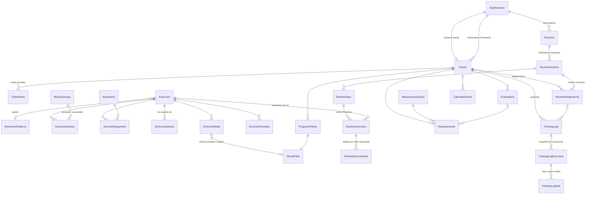

# LB METHOD · Fase 2: Modelo de datos y persistencia

> Estado: **entregada, pendiente de aprobación**. Implementa el modelo relacional en SQL Server con Entity Framework Core 10 sobre .NET 10. No incluye endpoints, inicio de sesión ni pantallas (Fases 3 y 4).

---

## 1. Qué se construyó

| Proyecto | Contenido |
|---|---|
| `backend/src/LBMethod.Domain` | Entidades C# del negocio, sin dependencias de frameworks. |
| `backend/src/LBMethod.Infrastructure` | `LBMethodDbContext` (incluye las tablas de ASP.NET Core Identity), configuraciones Fluent API, interceptores, catálogos iniciales y migración `InitialCreate`. |
| `backend/tests/LBMethod.IntegrationTests` | 22 pruebas automáticas contra un SQL Server real. |

Los proyectos `LBMethod.Application` y `LBMethod.Api` de la arquitectura aprobada se crearán en la Fase 3, cuando haya casos de uso y endpoints que poner en ellos.

**Resultado en base de datos:** 35 tablas, 56 llaves foráneas, 31 restricciones `CHECK` y 107 índices.

---

## 2. Diagrama entidad-relación



Además: `AuditLog` (bitácora, sin relaciones), y las tablas estándar de Identity (`AspNetRoles`, `AspNetUserRoles`, `AspNetUserClaims`, `AspNetUserLogins`, `AspNetUserTokens`, `AspNetRoleClaims`).

---

## 3. Cómo cumple las reglas de la guía

| Regla | Cómo se implementó |
|---|---|
| Ejercicio reutilizable en muchas rutinas | `RoutineExercises.ExerciseId` apunta al catálogo; no se copia el ejercicio. Probado. |
| Parámetros en la rutina, no en el ejercicio | Series, repeticiones mín./máx., peso sugerido + unidad, descanso, tempo, RIR, RPE, tipo de serie, superserie y notas están en `RoutineExercises` (y opcionalmente por serie en `RoutineExerciseSets`). Probado. |
| Versiones y historial sin sobrescritura | El contenido vive en `RoutineVersions`. Solo puede haber **un borrador** por rutina (índice único filtrado). Una versión **publicada no se puede modificar ni borrar**, ni sus días, ejercicios o series: lo impide un interceptor en el guardado. Probado en 5 escenarios. |
| Asignación con cliente, versión, inicio, fin y estado | `RoutineAssignments` con `RoutineVersionId`, `StartDate`, `EndDate` (≥ inicio, restricción CHECK) y `Status`. Una versión se asigna a varios clientes sin duplicarse. Probado. |
| Registro conserva lo realizado aunque cambie la rutina | `TrainingLogs` / `TrainingLogExercises` guardan copia del título, día, nombre del ejercicio y parámetros prescritos; `TrainingLogSets` guarda reps y peso reales. Probado editando la rutina y renombrando/desactivando el ejercicio. |
| Evitar sesiones duplicadas | Índice único filtrado: un cliente solo puede tener **una sesión en curso**. Probado. |
| Nada de programas en JSON | Rutinas, días, ejercicios y series son tablas relacionadas. |
| `decimal` para peso y medidas | `decimal(7,2)` cargas, `decimal(8,2)` medidas, `decimal(3,1)` RIR/RPE. Probado (72.35 y 62.5 sin pérdida). |
| Unidades consistentes | Cada peso se guarda **junto con su unidad** (kg/lb). Cada medida guarda su unidad. La base de datos rechaza un peso sin unidad. Peso corporal (`MeasurementKind.BodyWeight`) y carga de ejercicio están en tablas distintas. |
| Fechas y zona horaria | Fechas con hora en **UTC** (`datetime2`), leídas siempre como UTC. Fechas de calendario (nacimiento, inicio/fin, medición) como `date`, sin zona horaria. Probado. |
| `CreatedAt` / `UpdatedAt` | Automáticos en todas las entidades. Probado que `CreatedAt` no cambia al editar. |
| Eliminación lógica | Ejercicios, grupos, equipamiento, tipos de medida: `IsActive`. Clientes: `Status` + `DeactivatedAt`. Rutinas: `Status = Archived`. Archivos: `DeletedAt`. |
| No destruir historial | Ninguna relación borra en cascada salvo las partes internas de un borrador o de una sesión. La base de datos **rechaza borrar** un ejercicio usado en rutinas o un cliente con historial (probado con borrado directo en SQL). |
| Separación por entrenadora | `Clients.TrainerId`, `Routines.TrainerId`, `CalendarEvents.TrainerId`. El aislamiento de cada cliente se aplicará en la API (Fase 3). |
| Archivos privados | `StoredFiles` guarda metadatos (propietario, tipo, tamaño, hash, proveedor y ruta lógica), nunca una URL pública. Un medio de ejercicio es un archivo **o** un enlace externo, no ambos (restricción CHECK). |
| Contraseñas | Solo el hash de Identity (`PasswordHash`). No hay contraseñas en el código ni en el repositorio. |

### Otras restricciones verificadas por la base de datos
Repeticiones mín. ≤ máx.; series ≥ 1; RPE entre 1 y 10; RIR entre 0 y 10; descanso ≥ 0; medida > 0; un solo músculo principal por ejercicio; un ejercicio no puede ser variante de sí mismo; correo de cliente único (sin distinguir mayúsculas); nombres de ejercicio únicos en español y en inglés.

### Catálogos iniciales (no son datos de ejemplo)
- Roles `TRAINER` y `CLIENT`.
- 12 grupos musculares de la guía (Glúteos, Femoral, Cuádriceps, Abductores, Aductores, Pantorrillas, Espalda, Pecho, Hombros, Bíceps, Tríceps, Abdomen) con nombre en inglés.
- 7 tipos de medida de la guía (peso corporal en kg; cintura, cadera, glúteos, muslo, brazo y pantorrilla en cm). Editables.

No se cargó ningún ejercicio, cliente ni rutina: los agregarás tú.

---

## 4. Decisiones de diseño que conviene que revises

1. **Plantillas:** en lugar de una tabla `RoutineTemplates` separada, una rutina tiene un tipo (`Kind`: Programa o Plantilla). Crear una rutina desde una plantilla copia su contenido y guarda de qué versión vino (`SourceVersionId`). Así plantillas y rutinas usan el mismo constructor. Solo los programas se asignan (se validará en la Fase 6/7).
2. **`RoutineHistory`:** cubierto por `RoutineVersions` (cada versión publicada queda guardada) más `AuditLog`.
3. **`TrainingCalendar`:** no hizo falta una tabla aparte; `CalendarEvents` cubre entrenamientos programados, descansos, evaluaciones e inicio/fin de programas.
4. **Detalle por serie opcional:** puedes prescribir "4 × 8–12" en una sola fila, o, si lo necesitas, cada serie por separado (p. ej. 2 de calentamiento y 3 efectivas) en `RoutineExerciseSets`.
5. **Textos de los ejercicios:** nombre en español (obligatorio) e inglés (opcional, para importar desde Excel aunque falte). Descripción, instrucciones, errores frecuentes y consejos en un solo idioma (español). Si quieres esos textos también en inglés, se agrega en la Fase 5.
6. **Catálogo compartido:** ejercicios, grupos musculares y equipamiento son un catálogo único (no por entrenadora).

---

## 5. Pruebas ejecutadas

Entorno: SQL Server 2022 Developer (contenedor) en mi entorno en la nube, .NET SDK 10.0.114, EF Core 10.0.14. Cada ejecución crea una base de datos temporal, aplica la migración y la borra al terminar.

**Resultado: 22 de 22 pruebas aprobadas.**

| Prueba | Resultado |
|---|---|
| La migración se aplica y el modelo coincide con ella | ✅ |
| Catálogos iniciales de la guía cargados (12 músculos, 7 medidas, 2 roles) | ✅ |
| Un ejercicio se reutiliza en varias rutinas y no se puede borrar mientras se use | ✅ |
| Editar parámetros de la rutina no modifica el ejercicio maestro | ✅ |
| Una versión publicada no se puede modificar (título, parámetros, día nuevo, serie nueva, borrado) | ✅ |
| Un borrador sí se edita y luego se publica | ✅ |
| Solo un borrador por rutina; números de versión únicos | ✅ |
| Una asignación apunta a una versión concreta, compartida por varios clientes | ✅ |
| El registro de entrenamiento conserva su snapshot tras cambiar rutina y ejercicio | ✅ |
| Solo una sesión en curso por cliente | ✅ |
| La base de datos rechaza 9 tipos de datos inválidos | ✅ (9 casos) |
| Correo de cliente único sin distinguir mayúsculas | ✅ |
| Desactivar un cliente conserva su historial; no se puede borrar con datos | ✅ |
| Fechas en UTC, decimales exactos y marcas de tiempo automáticas | ✅ |

Pruebas adicionales manuales:
- Migración aplicada a la base `LBMethod_Dev` de la nube: 35 tablas creadas, acentos guardados correctamente.
- **Reversión:** aplicar → revertir (`database update 0`, quedan 0 tablas) → volver a aplicar. ✅
- **Script SQL idempotente** ejecutado dos veces seguidas sobre una base vacía sin errores. ✅

---

## 6. Cómo aplicarlo en tu computadora (Windows + SQL Server)

### Requisitos
- [.NET 10 SDK](https://dotnet.microsoft.com/download/dotnet/10.0) (`dotnet --version` debe mostrar 10.x).
- Tu SQL Server (Express o Developer). Conocer el nombre del servidor, por ejemplo `localhost\SQLEXPRESS` o `localhost`.
- Git, o descargar la rama `claude/project-thread-wllv8a` desde GitHub.

### Paso 1: respaldo previo
La migración crea una base de datos **nueva** (`LBMethod_Dev`), así que no toca otras bases. Si ya tuvieras una base con ese nombre y con datos, respáldala primero en PowerShell:

```powershell
sqlcmd -S localhost\SQLEXPRESS -E -Q "BACKUP DATABASE [LBMethod_Dev] TO DISK = N'C:\Respaldos\LBMethod_Dev_antes_fase2.bak' WITH INIT, CHECKSUM"
```
(La carpeta `C:\Respaldos` debe existir y SQL Server debe tener permiso para escribir en ella.)

### Paso 2: aplicar la migración (opción A, con .NET)
En PowerShell, dentro de la carpeta `backend` del proyecto:

```powershell
dotnet tool restore
$env:ConnectionStrings__LBMethod = "Server=localhost\SQLEXPRESS;Database=LBMethod_Dev;Trusted_Connection=True;TrustServerCertificate=True"
dotnet ef database update -p src/LBMethod.Infrastructure
```
La cadena de conexión solo vive en esa ventana de PowerShell; no se guarda en ningún archivo. `Trusted_Connection=True` usa tu usuario de Windows, sin contraseña.

### Paso 2 (opción B, con SQL Server Management Studio)
1. Crea una base vacía llamada `LBMethod_Dev`.
2. Abre `docs/sql/LBMethod_InitialCreate_idempotent.sql` y ejecútalo sobre esa base. Se puede ejecutar más de una vez sin duplicar nada.
   Si lo ejecutas con `sqlcmd`, agrega la opción `-I` (los índices filtrados lo necesitan; SSMS ya lo hace por defecto).

### Paso 3: ejecutar las pruebas en tu equipo (opcional)
Crean y borran su propia base temporal `LBMethod_Test_…`; no tocan `LBMethod_Dev`.
```powershell
$env:LBMETHOD_TEST_SQL = "Server=localhost\SQLEXPRESS;Integrated Security=True;TrustServerCertificate=True"
dotnet test
```

### Reversión
- **En desarrollo, sin datos importantes:** `dotnet ef database update 0 -p src/LBMethod.Infrastructure` elimina las tablas creadas por esta migración. ⚠️ Esto borra los datos de esas tablas.
- **Con datos:** restaura el respaldo del paso 1:
```powershell
sqlcmd -S localhost\SQLEXPRESS -E -Q "RESTORE DATABASE [LBMethod_Dev] FROM DISK = N'C:\Respaldos\LBMethod_Dev_antes_fase2.bak' WITH REPLACE"
```
- Regla para el futuro: cada nueva migración se revisará, se respaldará la base antes de aplicarla y en producción se aplicará con script idempotente, nunca automáticamente al arrancar la aplicación.

---

## 7. Archivos creados

```
.gitignore
docs/fase-02-modelo-de-datos.md
docs/sql/LBMethod_InitialCreate_idempotent.sql
backend/LBMethod.slnx
backend/dotnet-tools.json                              (herramienta dotnet-ef 10.0.14)
backend/src/LBMethod.Domain/
  Common/Entity.cs, Common/Enums.cs
  Clients/Client.cs
  Exercises/Exercise.cs
  Routines/Routine.cs
  Training/TrainingLog.cs
  Tracking/Measurement.cs
  Calendar/CalendarEvent.cs
  Files/StoredFile.cs
  Audit/AuditLog.cs
backend/src/LBMethod.Infrastructure/
  Identity/AppUser.cs
  Persistence/LBMethodDbContext.cs
  Persistence/PersistenceSetup.cs                     (configuración + fábrica para dotnet ef)
  Persistence/Configurations/*.cs                     (Fluent API: 7 archivos)
  Persistence/Interceptors/AuditTimestampsInterceptor.cs
  Persistence/Interceptors/PublishedVersionGuardInterceptor.cs
  Persistence/Seed/ReferenceData.cs
  Persistence/Migrations/20261030170517_InitialCreate*.cs
backend/tests/LBMethod.IntegrationTests/
  SqlServerFixture.cs, TestData.cs, DataModelTests.cs
```

Nota de seguridad: `Microsoft.Data.SqlClient` traía una versión de `System.Security.Cryptography.Pkcs` con vulnerabilidades conocidas; se fijó la versión corregida 10.0.14. La compilación queda sin advertencias.

---

## 8. Pendientes y decisiones abiertas

- **D5 Zona horaria y unidades:** el modelo ya guarda la unidad con cada valor, así que no bloquea. Falta saber tu zona horaria (para mostrar fechas) y si prefieres kg/cm por defecto.
- **D3 / D7 Archivos y videos:** el modelo admite disco local o nube y archivo o enlace; la implementación de subida es de la Fase 5.
- **D4 Correo** para invitaciones y recuperación de contraseña: necesario en la Fase 3.
- **D8 Una o varias entrenadoras:** el modelo ya registra `TrainerId`; confirma que por ahora solo serás tú.
- Revisión de las decisiones de diseño de la sección 4.
- Aplicar la migración en tu SQL Server de Windows (sección 6) cuando quieras; no es requisito para la Fase 3.
